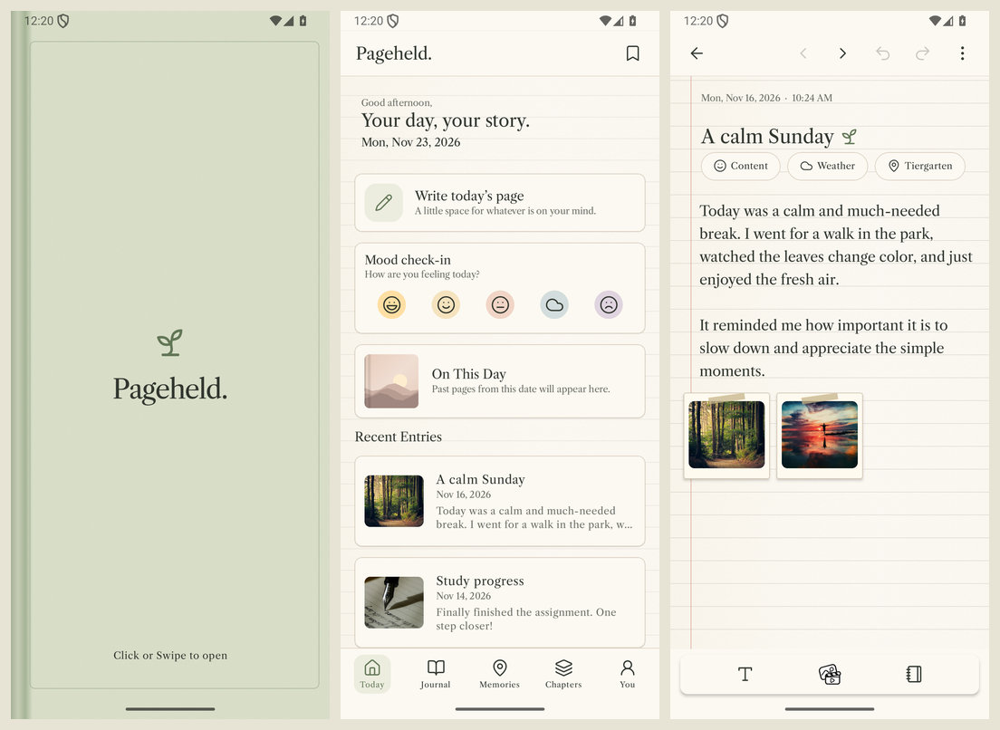

# Pageheld

Pageheld is a personal journal for Android. Write on ruled ivory paper, keep photos beside your words, and revisit pages by chapter or place. Your notebook stays on your device.

**[Download Pageheld for Android](https://github.com/minsmakes/Pageheld/releases/latest/download/Pageheld.apk)** · Android 9 or newer

## Install on your phone

1. On your Android phone, tap **Download Pageheld for Android** above. The file is called **Pageheld.apk**. An APK is an Android app installer.
2. Your browser may warn you about downloading an app file. Check that you followed the Pageheld link above before choosing **Download** or **Keep**.
3. Tap the finished download, or find **Pageheld.apk** in **Files → Downloads**. Pageheld comes from GitHub, outside Google Play. If Android asks for permission, tap **Settings**, enable **Allow from this source** for the browser or Files app that opened the download, then go back.
4. Tap **Install**, then **Open**. Keep Google Play Protect enabled and allow it to scan the app if asked. If it flags the app as harmful, stop the installation.
5. After installing, search your phone’s Settings for **Install unknown apps**, select the same browser or Files app, and turn **Allow from this source** off again. The wording varies by phone. [Android installation help](https://support.google.com/android/answer/9457058)

## Write your first page

Tap or swipe the green cover, then choose **Write today’s page**. Start typing and your words save automatically. Return to **Journal** to find the page again. In **You → Fonts**, you can change the handwriting or adjust the text size.

## Updates and backups

For a new version, use the same download link and tap **Update**. Android keeps your journal when it installs an update signed with the same key. For a backup, open **You**, export your encrypted notebook, and keep the file and its passphrase somewhere safe.

If you already use a development build, Android may report a signature conflict. Keep that copy installed while you export your notebook and check that you have the backup file and passphrase. Uninstalling Pageheld erases the journal stored on the device.



## Build from source

Open the repository root in Android Studio. Use JDK 21, install Android SDK Platform 37, sync Gradle, and run the `app` configuration on Android 9 (API 28) or later. On Windows with the SDK and JDK configured, build the debug APK with:

```powershell
.\gradlew.bat :app:assembleDebug
```

The APK is written to `app/build/outputs/apk/debug/app-debug.apk`. A fresh installation opens an empty journal. The pages, places and chapters in the screenshots are review fixtures from a dedicated emulator.

## Using the notebook

- Swipe or tap the cover to open your notebook. **You** contains the opening-cover and reduced-motion switches. Use the editor header arrows to turn between saved pages.
- Open **Write today’s page** or **+**. Edits save automatically. Use **Aa** for paper and writing preferences and the notebook icon for templates and chapters.
- Choose a photo or video in the Android picker. Pageheld copies the selected file into its private storage. Tap its thumbnail to reopen it.
- Search or filter in **Journal**. The calendar selects a date. Page options include bookmarking and deletion.
- Create a chapter with **+** in **Chapters**. Open a chapter for rename, reorder and delete actions. Its pages stay in Journal when the chapter is removed.
- Use the editor’s pin tool to add, edit, reorder or remove places on a page. Give each place a name or coordinates, optionally record a visit time and notes, and link page attachments. Submit a place, address or landmark to the device geocoder. Matching saved names appear locally while typing. Choose a result, adjust its pin and confirm **Add this place**. Tap the map or choose **Use current location** for a one-time fix. **Memories** groups saved entries by place. Its filters include a saved-place list that works without a map connection.
- In **You**, choose defaults or export an encrypted notebook with a passphrase. Import adds missing pages and chapters, restores appearance and check-ins, and preserves existing pages with matching IDs. Keep the passphrase for recovery.

Room stores pages and chapters. DataStore stores preferences and check-ins. MapLibre uses OpenFreeMap over the network for visible map areas. Pageheld requests foreground location permission when you choose a one-time fix. Export files contain journal text and attachments and support up to 256 MiB of uncompressed content.

See [implementation and verification details](docs/IMPLEMENTATION_STATUS.md), [the approved design brief](docs/design/PAGEHELD_CODEX_VISUAL_BRIEF.md), [Ownglyph font credits and license](docs/OWNGLYPH-LICENSE.md), [Libre Caslon Text’s license](app/src/main/assets/licenses/LibreCaslonText-OFL.txt), [Kalam’s license](docs/KALAM-LICENSE.txt), and [the icon license](docs/LUCIDE-LICENSE.txt).
