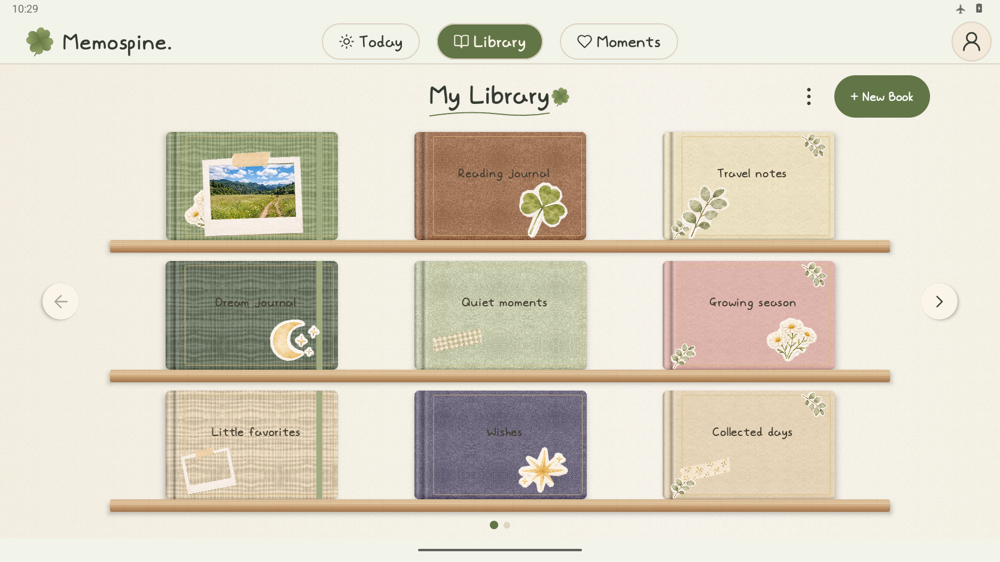
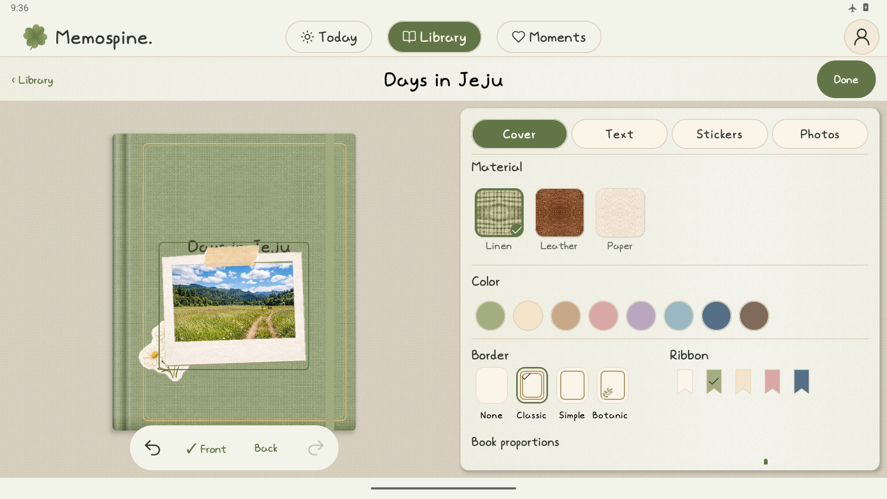
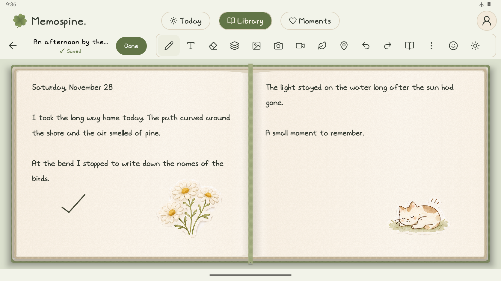
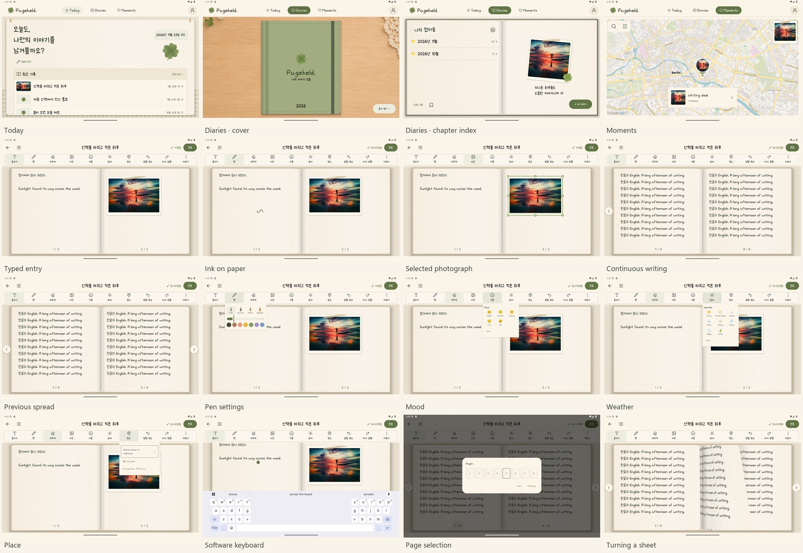

<p align="center"></p>

<h1 align="center">Memospine.</h1>

<p align="center">
  <a href="https://github.com/minsmakes/Pageheld/releases/latest/download/Pageheld.apk"></a>
  <a href="https://github.com/minsmakes/Pageheld/releases/latest/download/Pageheld-Tablet.apk"></a>
</p>

<p align="center"><a href="https://github.com/minsmakes/Pageheld/releases/download/v2.0-rc.1/Memospine-Tablet.apk"><strong>Download Memospine 2.0 tablet preview</strong></a></p>

<p align="center">Stable downloads above serve Pageheld 1.9.2 · Android 9 or newer</p>

Memospine (메모스파인) is a private Android library for personal journals &amp; memories. Write on ruled ivory paper, keep photos beside your words, and revisit pages by chapter or place. Your notebook stays on your device.

## Memospine 2.0 on tablets

The signed tablet preview is available on GitHub. If you already use Pageheld, export an encrypted backup from **Profile** before installing. Open `Memospine-Tablet.apk` on your tablet and choose **Update** over your current installation. The preview uses the existing app identity and signing certificate. [Tablet preview release](https://github.com/minsmakes/Pageheld/releases/tag/v2.0-rc.1)

If Android reports a signature conflict, your installation uses a different signing key, such as the development key. Keep Pageheld installed while you export an encrypted backup outside the app and verify that you have the file and passphrase. To switch signing keys, you must then uninstall the old app, install the preview and restore the backup from **Profile → Import**. Uninstalling erases the journal stored in the app.

Library holds nine books per shelf page. Select a book before opening Today or Moments. Entries and locations follow the selected book. Use **New Book** to create a cover, then open **Book Studio** to customize materials, lettering, photos and decorations. The phone edition continues to use the original single-notebook navigation.

[2.0 installation, upgrade and encrypted backup guidance](docs/design/v2.0/RELEASE_NOTES.md) · [Release progress and acceptance evidence](docs/design/v2.0/IMPLEMENTATION_STATUS.md) · [Book Studio artwork credits](docs/design/v2.0/source_assets/Pageheld_Asset_Pack_Vol01/README.md)

| Personal Library | Book Studio | Open book |
| --- | --- | --- |
| [](docs/design/v2.0/verification/library/actual.png) | [](docs/design/v2.0/verification/book_studio/actual.png) | [](docs/design/v2.0/verification/open_book/actual.png) |

These screenshots come from the running tablet candidate with a disposable journal. [Reference comparisons, test results and release limitations](docs/design/v2.0/RELEASE_VERIFICATION.md)

## Pageheld 1.7 screenshots

<p align="center"><a href="docs/design/screenshots/v1.7/overview.jpg"></a></p>

[Today](docs/design/screenshots/v1.7/today.png) · [Diary cover](docs/design/screenshots/v1.7/cover.png) · [Chapter index](docs/design/screenshots/v1.7/chapters.png) · [Moments](docs/design/screenshots/v1.7/moments.png) · [Diary editor](docs/design/screenshots/v1.7/typed.png)

## Install stable Pageheld on your Android device

1. Choose **Download for phone** (Pageheld.apk) or **Download for tablet** (Pageheld-Tablet.apk). An APK is an Android app installer.
2. Your browser may warn you about downloading an app file. Check that you followed the Pageheld link above before choosing **Download** or **Keep**.
3. Tap the finished download, or find the downloaded APK in **Files → Downloads**. Pageheld comes from GitHub, outside Google Play. If Android asks for permission, tap **Settings**, enable **Allow from this source** for the browser or Files app that opened the download, then go back.
4. Tap **Install**, then **Open**. Keep Google Play Protect enabled and allow it to scan the app if asked. If it flags the app as harmful, stop the installation.
5. After installing, search your phone’s Settings for **Install unknown apps**, select the same browser or Files app, and turn **Allow from this source** off again. The wording varies by phone. [Android installation help](https://support.google.com/android/answer/9457058)

## Write your first page

Today shows the local date and your latest writings. Choose **Today’s diary** to continue the day’s entry. In **Diaries**, open the stitched cover and choose a chapter or **New story**. Unfiled entries appear under their month. Custom chapters keep their original order and membership.

The toolbar switches between typing, pen, eraser, media, mood, weather and places. On wide tablets, the toolbar sits alongside the entry title to give the paper more vertical space. Text flows onto additional sheets as you write. Use **More → Add page** for a deliberate break. Tap the title to rename an entry, or choose the **Note** template under **Template & chapter**. The first import in each entry shows a short two-finger resizing hint. Tap a print to select it, drag to move and pinch to resize. Long-press to open the attachment viewer.

Choose **Done** to save your diary entry and return to its chapter. While you edit, changes stay in the open editor. If you go back or use **More → Navigate**, Memospine asks before discarding unsaved changes. Drafts saved in earlier versions are still available in your diary.

Choose **More → Appearance → Notebook theme** to switch between Sage, Denim, Rose and Umber. Each theme changes the interface and desk backgrounds. Tablet books keep their own cover colors. Use **Paper tone** to change the writing paper separately.

Tap **펜** to write with a stylus. Tap it again to choose an illustrated nib, adjust width, opacity and pressure with a live preview, save a favorite or enable finger writing. Tap the active **지우개** to choose whole-stroke or area erasing. **더보기 → 올가미 선택** lets you circle handwriting, drag it across the sheet and open **선택 편집** to copy, resize or rotate it.

Swipe across the paper to turn within the same dated entry. When drawing with a finger, swipe from the outer book margin. Turning past the last spread presents blank paper. Adding content saves the sheet. The deletion options in **더보기** identify the side and page number, and **실행 취소** restores a deleted saved sheet.

## Updates and backups

For a new version, use the same download link and tap **Update**. Android keeps your journal when it installs an update signed with the same key. For a backup, open the **profile icon**, export your encrypted notebook, and keep the file and its passphrase somewhere safe.

If you already use a development build, Android may report a signature conflict. Keep that copy installed while you export your notebook and check that you have the backup file and passphrase. Uninstalling the application erases the journal stored on the device.

## Digital Diary · November 24, 2026

Version 1.7 adds the three-tab interface, clover cloth cover, multi-page editor and photograph map. Tablets request landscape. Phones retain their normal orientation behavior. Personal settings include font import, paper, owner name, reduced motion and encrypted backups.

[Version 1.7 implementation and device verification](docs/DIGITAL_DIARY_1_7.md) · [Version 1.6 Quiet Hardcover history](docs/QUIET_HARDCOVER.md)

## Build from source

Open the repository root in Android Studio. Use JDK 21, install Android SDK Platform 37, sync Gradle, and run the `app` configuration on Android 9 (API 28) or later. On Windows with the SDK and JDK configured, build the debug APK with:

```powershell
.\gradlew.bat :app:assemblePhoneDebug :app:assembleTabletDebug
```

The debug installers are under `app/build/outputs/apk/phone/debug/` and `app/build/outputs/apk/tablet/debug/`. A fresh installation opens an empty journal. The pages, places and chapters in the screenshots are review fixtures from a dedicated emulator.

## Places and photographs

**Moments** opens an interactive map. Choose a photo marker to see linked memories. Search and filter places or switch to the saved list from the map controls. **Place** in the editor offers place search and recent locations. **Manage places** opens the existing map pin, GPS, notes, visit time, ordering and media associations.

Room stores entries, notebook layout, chapters and locations. DataStore stores preferences and check-ins. MapLibre uses OpenFreeMap over the network for visible map areas. Memospine requests foreground location permission when you choose a one-time fix. Export files contain journal text and attachments and support up to 256 MiB of uncompressed content.

See [implementation and verification details](docs/IMPLEMENTATION_STATUS.md), [the approved design brief](docs/design/PAGEHELD_CODEX_VISUAL_BRIEF.md), [Ownglyph font credits and license](docs/OWNGLYPH-LICENSE.md), [Libre Caslon Text’s license](app/src/main/assets/licenses/LibreCaslonText-OFL.txt), [Kalam’s license](docs/KALAM-LICENSE.txt), and [the icon license](docs/LUCIDE-LICENSE.txt).
